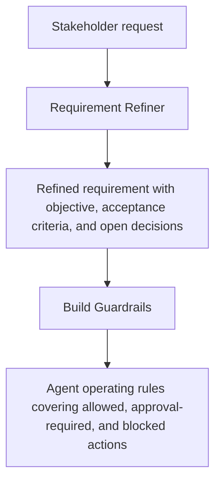

# AI Product Skills

Open-source Agent Skills for turning product ambiguity into delivery clarity.

[](LICENSE)
[](https://agentskills.io/)

`ai-product-skills` is a practical portfolio project for Product Managers, Product Owners, Business Analysts, QA professionals, and cross-functional delivery teams. Each skill captures a repeatable product workflow in instructions an AI agent can discover and apply.

**Requirement Refiner** clarifies what to build and why. **Build Guardrails** defines what the agent can do, what requires approval, and what is blocked during implementation.

## What are Agent Skills?

An Agent Skill is a folder of reusable instructions centered on a `SKILL.md` file. The file tells a compatible AI agent when to use the skill, what outcome to produce, and which supporting references to load. Skills can also contain templates, scripts, and other focused resources.

The two skills work together from intake through the SDLC Build phase.



Unlike a one-off prompt, a skill is versioned, reviewable, reusable, and easy to improve with examples and evaluations.

## Included skills

| Skill | Purpose | Status |
| --- | --- | --- |
| [`requirement-refiner`](skills/requirement-refiner/SKILL.md) | Convert ambiguous product requests into implementation-ready requirements | Available |
| [`build-guardrails`](skills/build-guardrails/SKILL.md) | Define Build-phase agent boundaries and how to enforce and verify them | Available |

The Requirement Refiner covers:

- the objective: why the feature is needed and what should improve;
- actor, trigger, and preconditions;
- current state, target state, and state transitions;
- expected behavior and failure paths;
- persistence and session behavior;
- platform impact and analytics;
- dependencies and edge cases;
- testable acceptance criteria; and
- explicit assumptions and open questions.

## Install

The repository follows the Agent Skills folder convention and is compatible with the `skills` CLI.

Install interactively:

```bash
npx skills add CinJ90/ai-product-skills
```

Install a single skill:

```bash
npx skills add CinJ90/ai-product-skills --skill requirement-refiner
npx skills add CinJ90/ai-product-skills --skill build-guardrails
```

To inspect the available skills before installing:

```bash
npx skills add CinJ90/ai-product-skills --list
```

You can also clone the repository and copy a skill folder from [`skills/`](skills) into the skills directory used by your AI agent.

## Use

Invoke the installed skill by name when your agent supports explicit skill invocation:

```text
Use $requirement-refiner to turn this request into an implementation-ready
requirement:

Allow shoppers to save a campaign promo before adding an eligible product.
Apply it automatically when the product is added to the cart.
```

You can also ask naturally:

```text
Refine this stakeholder request. Separate facts from assumptions, identify
material open questions, and produce testable acceptance criteria.
```

The skill does not silently invent product policy. When information is missing, it either asks a targeted question or states a bounded assumption so the delivery team can review it.

At the start of Build, pass the refined requirement and relevant repository or policy context to the next skill:

```text
Use $build-guardrails to review this feature before implementation.
Define what the agent may do, what needs approval, and what is blocked.
Suggest how to enforce and test those boundaries, including hooks where supported.
```

## Example

See the complete promo flow:

- [Ambiguous stakeholder request](examples/promo-application/request.md)
- [Implementation-ready output](examples/promo-application/refined-requirement.md)
- [Build guardrail plan](examples/promo-application/build-guardrails.md)

The example demonstrates a promo captured before the cart contains an eligible item, including pending and applied states, session persistence, revalidation, failure handling, analytics, and web/mobile impact.

## Evaluate the skill

The evaluations are deliberately runner-agnostic so they can be used in a manual review, an agent harness, or a CI workflow later.

- [`evals/requirement-refiner/cases.yaml`](evals/requirement-refiner/cases.yaml) contains realistic ambiguous inputs and observable expectations.
- [`evals/requirement-refiner/rubric.md`](evals/requirement-refiner/rubric.md) provides a 20-point scoring rubric and pass criteria.
- Build Guardrails has its own [cases](evals/build-guardrails/cases.yaml) and [rubric](evals/build-guardrails/rubric.md), including checks for bypassable hooks and a low-risk change.

Evaluate the skill's decisions and coverage, not whether it reproduces the example's wording.

## Repository structure

```text
ai-product-skills/
├── README.md
├── LICENSE
├── CONTRIBUTING.md
├── skills/
│   ├── requirement-refiner/
│   └── build-guardrails/
├── examples/
│   └── promo-application/
│       ├── request.md
│       ├── refined-requirement.md
│       └── build-guardrails.md
└── evals/
    ├── requirement-refiner/
    └── build-guardrails/
```

## Design principles

- **Traceable:** Each acceptance criterion should map to a stated behavior, risk, or rule.
- **Honest:** Facts, assumptions, recommendations, and open questions stay visibly separate.
- **Cross-functional:** The output should help product, design, engineering, QA, data, and operations reach the same understanding.
- **Testable:** Requirements describe observable outcomes rather than implementation details.
- **Portable:** Skills use a simple open folder format instead of depending on one model or vendor.

## Roadmap

Potential future skills include acceptance-criteria review, QA scenario generation, analytics tracking plans, PRD generation, and solution assessment. New skills will be added only when they have a clear workflow, a realistic example, and useful evaluation criteria.

## Contributing

Feedback, examples, and pull requests are welcome. See [CONTRIBUTING.md](CONTRIBUTING.md) for the quality bar and contribution flow.

## Author

Created by [CinJ90](https://github.com/CinJ90) as an open-source portfolio project demonstrating product thinking, structured requirements, and AI workflow design.

## License

Released under the [MIT License](LICENSE).
